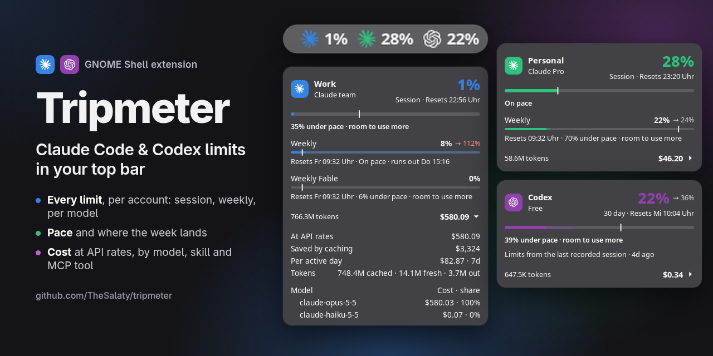
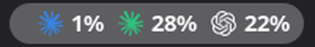
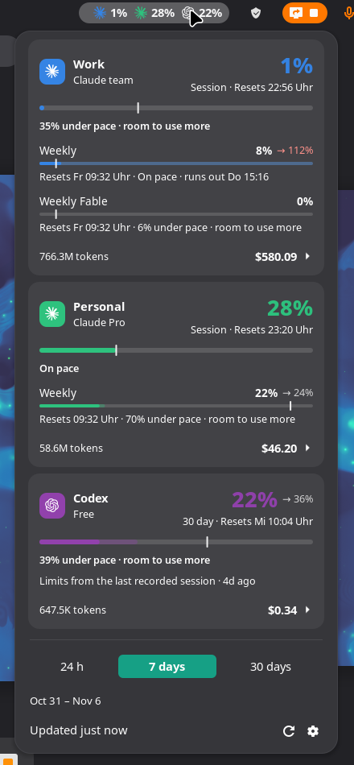
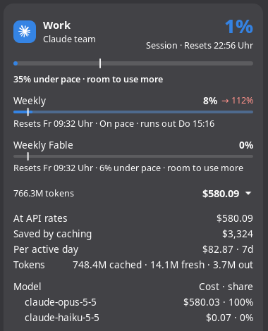
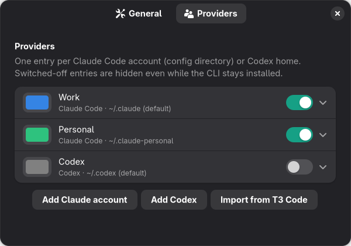

<p align="center">
  
</p>

# Tripmeter

[](https://github.com/TheSalaty/tripmeter/releases/latest)
[](#install)
[](LICENSE)

A GNOME Shell extension that puts your **Claude Code and OpenAI Codex usage limits in the top
bar**: the 5-hour session, the weekly limit, the per-model limits and when each one resets. A
marker on every bar tells you whether you are burning through the week or leaving quota on the
table, and a click shows what the same tokens would have cost at API rates.

- Claude Code, Codex, or both, with one card per account
- Several Claude accounts side by side (work and personal)
- Pace and a weekly forecast, not just a percentage
- Cost by model, skill, subagent and MCP tool
- No API key, no helper CLI, no telemetry. It reads the files the CLIs already write

<p align="center">
  
</p>

<p align="center">
  
</p>

## What it shows

**Every limit, per account.** Claude's 5-hour session, the weekly limit and the per-model weekly
limits; whatever windows Codex's plan has. One card per account, in the colour you gave it, and
one icon and percentage per account in the top bar.

**Pace.** The white tick on each bar is where an even spread would be right now. Left of it, you
have room to use more. Right of it, the line under the bar turns amber and tells you when the limit
runs out at the current rate, e.g. `13% over pace · runs out at 21:18`.

**Where the week lands.** Weekly bars carry a paler segment and an `est. 112% at reset`: the figure at reset if
your pace holds. It is weighted by your own weekday rhythm, so a quiet weekend ahead counts for
less than a Tuesday. 85–95% at reset is the sweet spot.

**Left or used.** Limits count down by default, like the usage pages of Claude and Codex: `74%`
is what you have left, the bar drains, room to use more is a bar ending right of the tick, and
the stretch of a weekly bar left of the gap is what the estimate leaves unused at reset.
Switch *Show limits as* to *Percent used* in the settings to count up instead; the figures above
are in that mode.

**What it would have cost.** Click the cost line on a card to see your tokens priced at API list
rates for the last 24 hours, 7 days or 30 days: by model, skill, subagent and MCP tool, plus what
prompt caching saved.

<p align="center">
  
</p>

**Several Claude accounts.** Work and personal logins live in separate config directories
(`CLAUDE_CONFIG_DIR`). Tripmeter reads each one as its own account. You can switch Codex off without
uninstalling it.

Nothing leaves your machine. Tripmeter reads the session files the CLIs already write. Its only
network request is the usage call Claude Code itself makes, sent with the token Claude Code already
stored. You don't need an API key or a helper CLI, and there is no telemetry.

GNOME Shell 49 and 50. Works with either CLI on its own or with both.

## Install

Download the zip from the [latest release](https://github.com/TheSalaty/tripmeter/releases/latest)
and install it:

```sh
gnome-extensions install --force ~/Downloads/tripmeter@thesalaty.github.io.shell-extension.zip
```

Log out and back in (GNOME on Wayland only loads new extensions at login), then:

```sh
gnome-extensions enable tripmeter@thesalaty.github.io
```

### From source

Needs Node.js 20 or newer.

```sh
git clone https://github.com/TheSalaty/tripmeter.git
cd tripmeter
npm install
make install
```

`make pack` builds the installable zip.

## Accounts

Open the settings from the gear in the menu, or with
`gnome-extensions prefs tripmeter@thesalaty.github.io`.

<p align="center">
  
</p>

The **Providers** tab has one row per Claude Code config directory or Codex home. Each row has a
name, a colour and an on/off switch. If you use T3 Code, **Import from T3 Code**
copies the names, accent colours and directories of the providers you set up there.

The same list is a JSON setting, so you can script it:

```sh
dconf write /org/gnome/shell/extensions/tripmeter/providers "'[
  {\"kind\": \"claude\", \"name\": \"Work\", \"color\": \"#3584e4\"},
  {\"kind\": \"claude\", \"name\": \"Personal\", \"color\": \"#2ec27e\", \"home\": \"~/.claude-personal\"},
  {\"kind\": \"codex\", \"enabled\": false}
]'"
```

An empty `home` means the CLI's default directory. `dconf reset` on the key goes back to every
installed CLI.

The **General** tab sets what the top bar shows (limits, cost or just the icon), the cost window
and the refresh interval.

## Prices

The price list is in [`src/lib/pricing.ts`](src/lib/pricing.ts). To override it, create
`~/.config/tripmeter/pricing.json` with prices in USD per million tokens:

```json
{
  "gpt-5.6": { "input": 5, "output": 30 },
  "claude-opus": { "input": 5, "output": 25, "cacheReadFactor": 0.1 }
}
```

The longest matching model prefix wins.

## FAQ

**How do I see my Claude Code usage limits on Linux without typing `/usage`?**
Install Tripmeter. The top bar then shows the 5-hour session percentage for each account, and the
menu has the weekly and per-model limits with their reset times. They are the same figures
`/usage` reports inside Claude Code.

**Does it show Codex limits too?**
Yes. Codex's limit windows get their own card, read from the most recent Codex session file.
Tripmeter works with Claude Code alone, Codex alone, or both.

**Do I need an API key, `ccusage` or another helper?**
No. Limits come from the usage call Claude Code itself makes, and tokens and cost come from the
session files in `~/.claude` and `~/.codex`.

**Can it track more than one Claude account?**
Yes. Each `CLAUDE_CONFIG_DIR` is its own account with a name, a colour and its own card and
top-bar figure.

**Is the cost what I pay?**
No. It is what the same tokens would cost at API list prices. A subscription is flat-rate, so
read it as "what this plan is worth to me", not as a bill.

**Is there something like CodexBar for GNOME?**
CodexBar is a macOS menu bar app. Tripmeter is an independent project that covers the same need
on GNOME Shell for Claude Code and Codex. It is GNOME only: no KDE Plasma, Waybar or macOS.

**Does it work on Wayland?**
Yes, on GNOME Shell 49 and 50.

## Fine print

- The cost is what the same tokens would cost on the API. A subscription is flat-rate, so it is not
  a bill.
- Claude's OAuth token is only read, never refreshed. Refreshing it here would log Claude Code out.
  If it has expired, start Claude Code once.
- api.anthropic.com rate-limits the usage endpoint hard. Tripmeter caches each account's limits for
  a few minutes and keeps the last good reading if a request is refused.
- Codex limits come from its most recent session file and only change when Codex runs.
- The weekly forecast looks back at most 16 days. Codex's comes from the limit history in its
  session files. Claude publishes no history, so Tripmeter records a daily figure as it runs, and
  the forecast gets better over the first two weeks. It is a projection, not a promise.

## Contributing

Pull requests are welcome, and so are issues for bugs, wrong prices or a limit that reads
differently from what `/usage` shows. [docs/DEVELOPMENT.md](docs/DEVELOPMENT.md) covers the build,
the tests and how to look at the UI in a headless shell without touching your session. Run
`npm test` before you open a PR.

## License

[MIT](LICENSE). Not affiliated with Anthropic or OpenAI.
